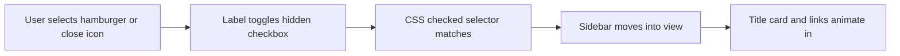

# Frontend Mini Projects


A repository for focused front-end projects, each kept in its own directory so it can be opened and studied independently. The current project is a sidebar navigation panel built entirely with HTML and CSS.

## Overview

The repository currently contains one project, **Responsive Sidebar**: an off-canvas navigation panel for a photography-themed page. It opens and closes without any JavaScript, using a hidden checkbox and CSS selectors to manage state, and combines a frosted-glass surface with staged entrance animations.

## Projects

| Project | Directory | Description | Technologies |
| --- | --- | --- | --- |
| Responsive Sidebar | [`Responsive-sidebar`](Responsive-sidebar) | CSS-only off-canvas navigation panel with a frosted-glass design | HTML, CSS, Font Awesome |

## Key Features

- Sidebar toggle implemented entirely in CSS, with no JavaScript
- Frosted-glass effect using `backdrop-filter` over a full-page background image
- Staged entrance transitions for the title card and navigation links
- Hover feedback on navigation links, social icons, and the toggle controls
- Full-height panel and full-page background sized to the viewport
- Hamburger and close controls using Font Awesome icons

## Technology Stack

| Component | Technology |
| --- | --- |
| Markup | HTML5 |
| Styling | CSS3 (Flexbox, transitions, transforms, `backdrop-filter`) |
| Icons | Font Awesome 7.0.1, loaded from a CDN |

## Architecture and Workflow

The open and closed states are held by a hidden checkbox. Both the hamburger icon and the close icon are labels for that checkbox, so selecting either one toggles the state, and CSS sibling selectors respond to the change.



## Project Structure

```text
Frontend-Mini-Projects/
├── Responsive-sidebar/
│   ├── new.html
│   ├── new.css
│   └── photo.jpg
└── README.md
```

## Installation and Setup

No build step or package installation is required.

```bash
git clone https://github.com/Partha-Shankar/Frontend-Mini-Projects.git
cd Frontend-Mini-Projects
```

An internet connection is needed to load the Font Awesome icons from the CDN.

## Usage

Open `Responsive-sidebar/new.html` in a web browser, or serve the directory locally, for example with Python:

```bash
cd Responsive-sidebar
python -m http.server 8000
```

Then visit `http://localhost:8000/new.html`. Select the hamburger icon in the top-left corner to open the sidebar, and the close icon to dismiss it.

## Technical Implementation

### State Management

The checkbox `#sidebar-toggle` is hidden, and the selector `input:checked ~ .sidebar` moves the panel from `left: -600px` to `left: 0`. A second selector hides the hamburger icon while the panel is open.

### Visual Design

The panel uses a translucent white background with `backdrop-filter: blur(10px)`, including the `-webkit-` prefixed property for wider browser support. Rounded right corners and a subtle shadow separate it from the background image.

### Animation

The title card and navigation links begin slightly scaled down and transparent, with the links also offset to the left. Once the panel opens, they transition into place after a 0.5 second delay, using a custom `cubic-bezier` timing function for the transform.

### Layout

The panel uses Flexbox to arrange the title card, the navigation links, and the social icons, and viewport units (`vh`) to set its width and height.

## Future Scope

- Additional front-end projects, each in its own directory
- Linking the navigation entries, which are currently placeholders, to real pages
